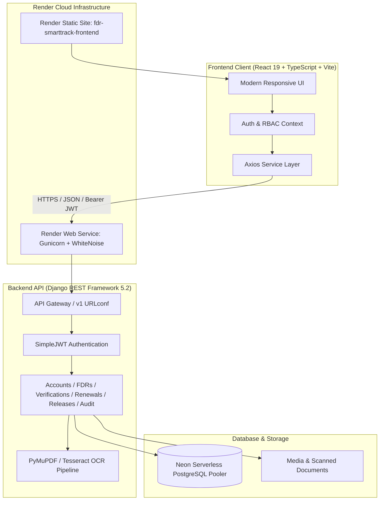

<p align="center">
  
</p>

<h1 align="center">FDR SmartTrack</h1>

<p align="center">
  <b>Regulatory Fixed Deposit Receipt (FDR) Repository & Automated Verification System</b><br />
  <i>Engineered for AICTE & Government Educational Regulatory Authorities</i>
</p>

<p align="center">
  <a href="https://fdr-smarttrack-frontend.onrender.com"></a>
  <a href="https://fdr-smarttrack-backend.onrender.com/api/v1/"></a>
  <a href="https://github.com/AdeepMohamed/Fdr-project"></a>
</p>

<p align="center">
  
  
  
  
  
  
  
</p>

---

## 📑 Table of Contents

- [📌 Problem Statement & Overview](#-problem-statement--overview)
- [🌟 Key Features & Innovations](#-key-features--innovations)
- [🌐 Live Deployment & Demo Credentials](#-live-deployment--demo-credentials)
- [🏗️ System Architecture](#-system-architecture)
- [🛠️ Technology Stack](#-technology-stack)
- [📂 Repository Structure](#-repository-structure)
- [🚀 Local Development Setup](#-local-development-setup)
- [📋 Core API Reference](#-core-api-reference)
- [⚡ Performance & Production Optimizations](#-performance--production-optimizations)
- [🔒 Security & Compliance](#-security--compliance)
- [🤝 Contributing & License](#-contributing--license)

---

## 📌 Problem Statement & Overview

Higher education regulatory authorities, such as the **All India Council for Technical Education (AICTE)**, require technical and professional colleges to deposit substantial **Fixed Deposit Receipts (FDRs)** as mandatory joint security endowments to guarantee financial stability and student welfare.

### The Real-World Challenges
* **Dispersed Paper Records**: Physical certificates kept across multiple regional bureaus risk being misplaced, damaged, or lost.
* **Maturity Lapses**: Without automated tracking, deposits mature unnoticed, resulting in lost compound interest and unrenewed security guarantees.
* **Document Forgery & Manual Auditing**: Comparing declared FDR details against scanned paper receipts manually is slow and susceptible to forged or manipulated documents.
* **Prolonged Release Procedures**: Returning security deposits upon course cessation or institutional tenure completion requires rigorous verification across multiple offices.

### The Solution: FDR SmartTrack
**FDR SmartTrack** is an enterprise-grade cloud portal that automates the complete lifecycle of regulatory security deposits. Integrating **automated OCR document extraction**, **algorithmic discrepancy cross-checks**, **30/15/7-day proactive maturity alerts**, and **immutable audit logging**, FDR SmartTrack establishes complete transparency, accuracy, and operational efficiency.

---

## 🌟 Key Features & Innovations

### 1. 🔍 Automated OCR & AI Discrepancy Detection
* Institutions upload certificate scans (PDF or image).
* The embedded OCR service extracts structured data (Certificate Number, Bank Name, Branch, Principal Amount, Maturity Date, Joint Signatories).
* The discrepancy engine calculates match confidence scores and visually flags discrepancies directly in the Official Review Queue.

### 2. 🛡️ Three-Tier Role-Based Access Control (RBAC)
* **Bureau Administrator**: Comprehensive oversight, regulatory parameters, bureau analytics, and immutable system audit logs.
* **AICTE Official (SRO / Regional Officer)**: Verification Queue, side-by-side OCR comparison, approval/rejection with remarks, and deposit release verification.
* **Institution Signatory**: Institute-specific deposit dashboard, digital FDR submissions, certificate uploads, renewal tracking, and official release petitions.

### 3. ⏰ Proactive Maturity Countdown & Timelines
* Real-time color-coded countdown indicators:
  * 🔴 **Critical**: Matured / overdue or expiring within 15 days.
  * 🟡 **Upcoming**: Expiring within 16–60 days.
  * 🟢 **Active**: Securely locked, maturity > 60 days.
* Automated periodic background reminders triggered at **30, 15, 7, and 0 days** before deposit maturity.

### 4. 🔄 End-to-End Deposit Lifecycle Management
* **Deposit Registration**: Joint holder validation, IFSC verification, lock-in period enforcement.
* **Renewal Pipeline**: Streamlined petitioning with revised deposit receipts, terms, and approval workflows.
* **Secure Release Workflows**: Multi-step verification, clearance checklist, approval sign-off, and digitally verifiable release certificates.

### 5. 📜 Immutable Audit Trail (ISO 27001 Compliant)
* Every system mutation (record creation, status change, certificate upload, verification, release) is timestamped with user ID, role, IP address, and state diff.

---

## 🌐 Live Deployment & Demo Credentials

* **Frontend Web Application**: [https://fdr-smarttrack-frontend.onrender.com](https://fdr-smarttrack-frontend.onrender.com)
* **Backend API Base**: [https://fdr-smarttrack-backend.onrender.com/api/v1/](https://fdr-smarttrack-backend.onrender.com/api/v1/)
* **Django Admin**: [https://fdr-smarttrack-backend.onrender.com/admin/](https://fdr-smarttrack-backend.onrender.com/admin/)

### Verified Test Accounts

| Role | Username / Email | Password | Access Privileges |
| :--- | :--- | :--- | :--- |
| **Bureau Admin** | `admin@aicte.gov.in` | `Admin@123` | Complete administrative authority, all institution records, audit logs |
| **AICTE Official (SRO)** | `official@aicte.gov.in` | `Official@123` | Official verification queue, discrepancy reviews, approval workflows |
| **Institution (Delhi Tech)** | `director@delhitech.edu.in` | `College@123` | College deposit portfolio, new FDR submissions, renewal tracking |
| **Institution (MIT Pune)** | `principal@mitpune.edu.in` | `College@123` | College deposit portfolio, matured deposit alerts, release petition |

---

## 🏗️ System Architecture



---

## 🛠️ Technology Stack

| Layer | Technologies |
| :--- | :--- |
| **Frontend** | React 19, TypeScript, Vite, Tailwind CSS, Lucide React, Recharts, React Router v7 |
| **Backend** | Python 3.11+, Django 5.2, Django REST Framework, SimpleJWT, WhiteNoise, Gunicorn |
| **Database** | PostgreSQL (Neon Serverless Pooler with SSL) / SQLite fallback |
| **Document Processing** | PyMuPDF (`fitz`), Pillow, PyTesseract |
| **Cloud Hosting** | Render (Web Service & Static Site), Cloudflare CDN |

---

## 📂 Repository Structure

```text
Fdr-project/
├── backend/                        # Django REST Framework Backend
│   ├── apps/                       # Modular business domain apps
│   │   ├── accounts/               # Custom User model, RBAC roles, JWT auth
│   │   ├── audit/                  # Immutable audit logs and event tracking
│   │   ├── documents/              # FDR document uploads & OCR service
│   │   ├── fdrs/                   # FDR records, deposits, metadata
│   │   ├── institutions/           # College profiles & memberships
│   │   ├── notifications/          # Automated maturity alerts & email queues
│   │   ├── releases/               # Security deposit release petitions
│   │   ├── renewals/               # Deposit renewal management
│   │   ├── reports/                # Compliance analytics & exports
│   │   └── verifications/          # Discrepancy detector & verification queue
│   ├── config/                     # Django core settings, WSGI, URLs
│   ├── build.sh                    # Automated cloud build script
│   ├── Procfile                    # WSGI process definition
│   ├── requirements.txt            # Production Python dependencies
│   └── README.md                   # Dedicated backend documentation
│
├── frontend/                       # React + TypeScript + Vite Frontend
│   ├── public/                     # Icons, favicon, static assets
│   ├── src/
│   │   ├── components/             # Reusable UI components, Modals, Navbar, Sidebar
│   │   ├── context/                # Authentication & Live Tour contexts
│   │   ├── pages/                  # Dashboard, FDRDetail, FDRList, VerificationQueue, etc.
│   │   ├── services/               # Axios API client & typed backend service calls
│   │   ├── types/                  # TypeScript interface definitions
│   │   ├── App.tsx                 # Client-side router configuration
│   │   └── index.css               # Design system & styling tokens
│   ├── package.json                # Frontend dependencies & scripts
│   ├── vercel.json                 # SPA routing rewrites for Vercel/Netlify
│   ├── vite.config.ts              # Vite bundler & local API proxy
│   └── README.md                   # Dedicated frontend documentation
│
├── docs/                           # Project assets & architectural documentation
│   └── fdr-logo.svg                # Vector brand logo
├── render.yaml                     # Render Infrastructure-as-Code Blueprint
├── .gitignore                      # Git ignore rules for Python, Node, secrets
└── README.md                       # Master project documentation
```

---

## 🚀 Local Development Setup

### Prerequisites
* **Python 3.11+** installed ([python.org](https://www.python.org/))
* **Node.js 18+** and `npm` installed ([nodejs.org](https://nodejs.org/))
* **Git** installed ([git-scm.com](https://git-scm.com/))

### 1. Clone the Repository
```bash
git clone https://github.com/AdeepMohamed/Fdr-project.git
cd Fdr-project
```

### 2. Backend Setup
```bash
cd backend

# Create virtual environment
python -m venv .venv

# Activate virtual environment
# Windows (PowerShell):
.\.venv\Scripts\Activate.ps1
# Linux / macOS:
source .venv/bin/activate

# Install dependencies
pip install -r requirements.txt

# Run migrations & seed realistic demo data
python manage.py migrate
python manage.py seed_demo_data

# Start backend server
python manage.py runserver 127.0.0.1:8000
```
> Backend API will be active at: `http://127.0.0.1:8000/api/v1/`

### 3. Frontend Setup
In a new terminal window:
```bash
cd frontend

# Install dependencies
npm install

# Start Vite development server
npm run dev
```
> Web Application will be live at: **`http://localhost:5173/`**

---

## 📋 Core API Reference

All API endpoints are prefixed with `/api/v1/`.

| Method | Endpoint | Description | Access Level |
| :--- | :--- | :--- | :--- |
| `POST` | `/api/v1/auth/token/` | Obtain JWT token pair (access + refresh) | Public |
| `POST` | `/api/v1/auth/token/refresh/` | Refresh expired access token | Public |
| `GET` | `/api/v1/auth/users/me/` | Current user profile & permissions | Authenticated |
| `GET` | `/api/v1/fdrs/` | List FDR records (filtered by role) | Authenticated |
| `POST` | `/api/v1/fdrs/` | Register new FDR record | Institution / Admin |
| `GET` | `/api/v1/fdrs/{id}/` | Retrieve full FDR details & audit trail | Authenticated |
| `POST` | `/api/v1/documents/` | Upload certificate scan & trigger OCR | Institution / Admin |
| `GET` | `/api/v1/verifications/queue/` | Official review queue with discrepancy flags | Official / Admin |
| `POST` | `/api/v1/verifications/{id}/verify/`| Approve or reject FDR verification | Official / Admin |
| `POST` | `/api/v1/renewals/` | Submit FDR renewal petition | Institution / Admin |
| `POST` | `/api/v1/releases/` | Initiate deposit release request | Institution / Admin |
| `GET` | `/api/v1/audit-logs/` | Query immutable audit events | Admin |
| `GET` | `/api/v1/reports/summary/` | Dashboard metrics and compliance summaries | Authenticated |

---

## ⚡ Performance & Production Optimizations

* **WhiteNoise Static File Serving**: Pre-compressed assets with `CompressedManifestStaticFilesStorage` for low-latency delivery.
* **Serverless Database Pooling**: Optimized PostgreSQL connection management via Neon's connection pooler (`conn_max_age=0`).
* **Vite Production Bundling**: Treeshaking, ES module chunks, and minified bundles under 200 KB total.
* **SPA Routing Fallback**: Clean URL rewrites (`/* -> /index.html`) on both Render and Vercel preventing 404 errors on page refresh.
* **Silent Token Rotation**: Automatic Axios interceptor seamlessly refreshes JWT tokens before expiration.

---

## 🔒 Security & Compliance

* **Strict Role-Based Scoping**: Institution accounts can only query and mutate their own institution's deposits.
* **Zero Secret Leakage**: Database URLs, secret keys, and credentials isolated from source code via `.env` and Render secrets.
* **CORS Origin Whitelisting**: Granular control over trusted client origins.
* **Sanitized File Uploads**: Upload size ceiling of 10MB with MIME-type and extension validation.

---

## 🤝 Contributing & License

Contributions, issues, and feature requests are welcome!

1. Fork the Project
2. Create your Feature Branch (`git checkout -b feature/NewFeature`)
3. Commit your Changes (`git commit -m 'Add NewFeature'`)
4. Push to the Branch (`git push origin feature/NewFeature`)
5. Open a Pull Request

Distributed under the **MIT License**.

---

<p align="center">
  <b>FDR SmartTrack</b> &bull; Built for Transparent & Automated Regulatory Governance<br />
  <sub>Developed & Maintained by <a href="https://github.com/AdeepMohamed">Adeep Mohamed</a></sub>
</p>
