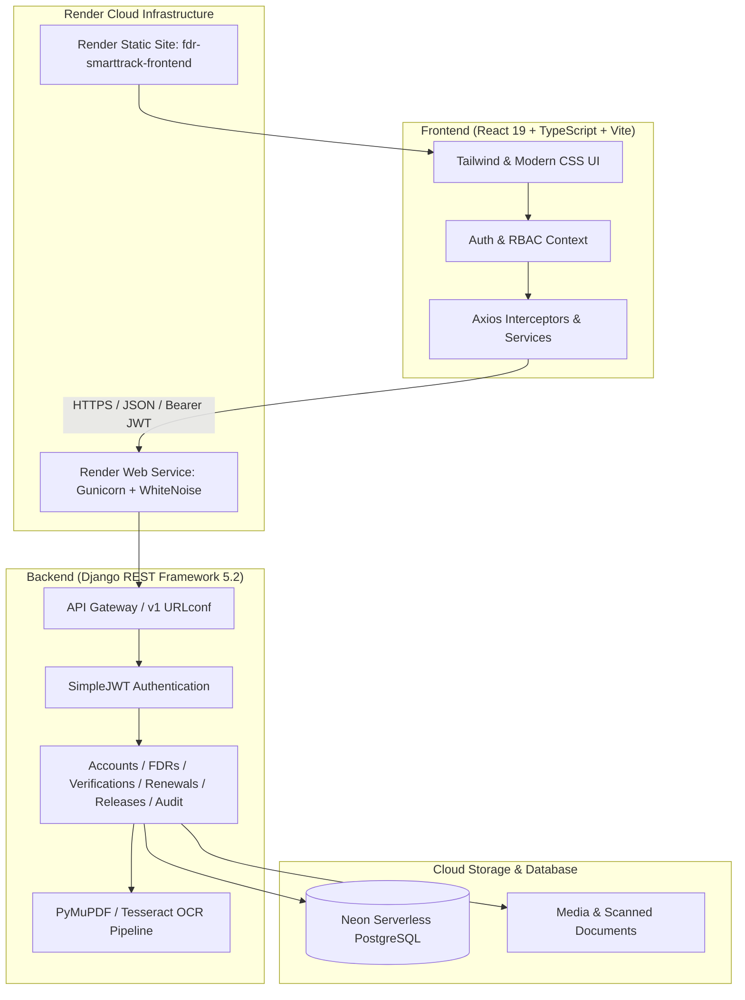

# FDR SmartTrack – Regulatory Security Deposit & Maturity Management System

<p align="center">
  
</p>

<p align="center">
  <b>A comprehensive, automated portal for managing, verifying, and tracking Fixed Deposit Receipts (FDRs) and joint security deposits for AICTE and regulatory bodies.</b>
</p>

<p align="center">
  <a href="https://fdr-smarttrack-frontend.onrender.com"></a>
  <a href="https://fdr-smarttrack-backend.onrender.com/api/v1/"></a>
  <a href="https://github.com/AdeepMohamed/Fdr-project"></a>
</p>

<p align="center">
  
  
  
  
  
  
  
</p>

---

## 📌 Problem Statement & Overview

Higher education regulatory bodies (such as the **All India Council for Technical Education – AICTE**) require technical and management institutions to submit substantial **Fixed Deposit Receipts (FDRs)** as mandatory joint security deposits/endowments. 

### The Challenges:
* **Manual Record Keeping**: Paper certificates stored across regional offices are vulnerable to loss, damage, and misplaced tracking.
* **Maturity Lapses**: Failure to monitor maturity dates leads to unrenewed or dormant deposits without interest recalculation.
* **Verification Delays & Fraud**: Manual comparison of physical bank FDR certificates against college applications is error-prone and vulnerable to forged documentation.
* **Opaque Release Workflows**: When institutions apply to release their deposits upon course closure or tenure completion, the clearance process is protracted and lacks auditability.

### The Solution:
**FDR SmartTrack** is a secure, role-based, cloud-native platform that digitizes the entire lifecycle of regulatory security deposits. Featuring **automated OCR document extraction**, **real-time mismatch detection**, **proactive 30/15/7-day maturity countdowns**, and **immutable audit logging**, FDR SmartTrack ensures complete regulatory compliance and transparency.

---

## 🌟 Key Features

### 1. 🔍 Automated OCR & AI Discrepancy Detection
* Institutions upload scanned FDR certificates (PDF or images).
* The embedded OCR extraction service parses certificate text (FDR Number, Bank Name, Principal Amount, Issue Date, Maturity Date, and Joint Account Holders).
* Automated verification cross-references declared fields with scanned data, flagging mismatches directly to inspecting officials.

### 2. 🛡️ Three-Tier Role-Based Access Control (RBAC)
* **Bureau Administrator**: Global administrative governance, bureau overview metrics, user administration, system-wide configuration, and audit trails.
* **AICTE Official (SRO / Regional Officer)**: Access to the **Verification Queue**, side-by-side OCR review, approval/rejection with remarks, renewal authorizations, and deposit release requests.
* **Institution Signatory**: Institute-specific deposit dashboard, digital FDR submissions, document uploads, renewal tracking, and official release petitions.

### 3. ⏰ Proactive Maturity Tracker & Timelines
* Color-coded countdown meters:
  * 🔴 **Critical**: Matured / overdue or expiring within 15 days.
  * 🟡 **Upcoming**: Expiring within 16–60 days.
  * 🟢 **Active / Safe**: Maturity > 60 days.
* Automated periodic background reminders sent at **30, 15, 7, and 0 days** prior to maturity.

### 4. 🔄 End-to-End Deposit Lifecycle Management
* **Deposit Creation**: Multi-currency support, joint FDR holders, branch IFSC, and lock-in periods.
* **Renewal Management**: Renewal petition submission with revised deposit receipts, terms, and approval workflows.
* **Safe Release Workflows**: Multi-step verification, clearance checklist, approval sign-off, and digitally verifiable release certificates.

### 5. 📜 Immutable Audit Trail (ISO 27001 Compliant)
* Every system action (create, edit, verify, reject, release, login, download) is recorded with timestamp, acting user, IP address, and previous/new state diffs.

### 6. 📊 Real-Time Analytics & Reporting
* Visual distribution of deposits by bank, institution type, and regional bureau.
* Exportable compliance registers (PDF / CSV / Excel format).

---

## 🌐 Live Deployment & Demo Credentials

* **Frontend Web Application**: [https://fdr-smarttrack-frontend.onrender.com](https://fdr-smarttrack-frontend.onrender.com)
* **Backend API Base**: [https://fdr-smarttrack-backend.onrender.com/api/v1/](https://fdr-smarttrack-backend.onrender.com/api/v1/)
* **Django Admin**: [https://fdr-smarttrack-backend.onrender.com/admin/](https://fdr-smarttrack-backend.onrender.com/admin/)

### Pre-Seeded Test Accounts

| Role | Username / Email | Password | What You Can Explore |
| :--- | :--- | :--- | :--- |
| **Bureau Admin** | `admin@aicte.gov.in` | `Admin@123` | Complete overview, global analytics, audit logs, institution management |
| **AICTE Official (SRO)** | `official@aicte.gov.in` | `Official@123` | Verification queue, side-by-side OCR discrepancy review, approvals |
| **Institution (Delhi Tech)** | `director@delhitech.edu.in` | `College@123` | College deposit portfolio, new FDR submission, renewal requests |
| **Institution (MIT Pune)** | `principal@mitpune.edu.in` | `College@123` | College deposit portfolio, matured deposit alerts, release petition |

---

## 🏗️ Architecture & Technology Stack



### Stack Breakdown

| Layer | Technologies Used |
| :--- | :--- |
| **Frontend** | React 19, TypeScript, Vite, Tailwind CSS, Lucide React, Recharts, React Router v7 |
| **Backend** | Python 3.11+, Django 5.2, Django REST Framework, SimpleJWT, WhiteNoise, Gunicorn |
| **Database** | PostgreSQL (Neon Serverless Pooler with SSL) / SQLite fallback |
| **Document Processing** | PyMuPDF (`fitz`), Pillow, PyTesseract |
| **DevOps & Cloud** | Render (Web Service & Static Site), GitHub Actions, Docker-ready |

---

## 📂 Project Structure

```text
fdr-project/
├── backend/                        # Django REST Framework Backend
│   ├── apps/
│   │   ├── accounts/               # Custom User model, RBAC roles, JWT auth
│   │   ├── audit/                  # Immutable audit logs and tracking
│   │   ├── documents/              # FDR document uploads & OCR service
│   │   ├── fdrs/                   # FDR records, deposits, metadata
│   │   ├── institutions/           # College/University profiles & memberships
│   │   ├── notifications/          # Automated maturity alerts & email triggers
│   │   ├── releases/               # Security deposit release requests
│   │   ├── renewals/               # Deposit renewal management
│   │   ├── reports/                # Analytics and statistical exports
│   │   └── verifications/          # Discrepancy detector & verification queue
│   ├── config/                     # Django core settings, WSGI, URLs
│   ├── build.sh                    # Render/Linux automated build script
│   ├── Procfile                    # Production WSGI process definition
│   ├── pyproject.toml / uv.lock    # Python packaging dependencies
│   └── requirements.txt            # Production Python requirements
│
├── frontend/                       # React + TypeScript + Vite Frontend
│   ├── public/                     # Icons, favicon, static assets
│   ├── src/
│   │   ├── assets/                 # SVGs and branding graphics
│   │   ├── components/             # Reusable UI components, Modals, Navbar, Sidebar
│   │   ├── context/                # Authentication & Live Tour contexts
│   │   ├── pages/                  # Dashboard, FDRDetail, FDRList, VerificationQueue, etc.
│   │   ├── services/               # Axios API client & typed backend service calls
│   │   ├── types/                  # TypeScript interface definitions
│   │   ├── App.tsx                 # Client-side router configuration
│   │   └── index.css               # Design system, theme tokens, styling
│   ├── package.json                # Frontend dependencies & scripts
│   ├── tsconfig.json               # TypeScript compiler configuration
│   ├── vercel.json                 # SPA routing rewrites for Vercel/Netlify
│   └── vite.config.ts              # Vite bundler configuration & local API proxy
│
├── docs/                           # Architectural guides and documentation
├── render.yaml                     # Render Infrastructure-as-Code Blueprint
├── .gitignore                      # Git ignore rules for Python, Node, secrets
└── README.md                       # Comprehensive documentation
```

---

## 🚀 Local Development Setup

### Prerequisites
* **Python 3.11+** installed ([python.org](https://www.python.org/))
* **Node.js 18+** and `npm` installed ([nodejs.org](https://nodejs.org/))
* **Git** installed ([git-scm.com](https://git-scm.com/))
* *(Optional)* Tesseract OCR if running full image-based OCR locally.

---

### Step 1: Clone the Repository

```bash
git clone https://github.com/AdeepMohamed/Fdr-project.git
cd Fdr-project
```

---

### Step 2: Backend Setup

```bash
cd backend

# Create and activate Python virtual environment
python -m venv .venv

# On Windows (PowerShell):
.\.venv\Scripts\Activate.ps1
# On Linux/macOS:
source .venv/bin/activate

# Install dependencies
pip install -r requirements.txt

# Create .env file (or copy from .env.example)
cp .env.example .env
```

#### Run Migrations & Seed Demo Data:
```bash
# Run database migrations
python manage.py migrate

# Seed sample institutions, users, FDRs, and test discrepancies
python manage.py seed_demo_data

# Start Django development server
python manage.py runserver 127.0.0.1:8000
```
> The Django backend will be available at: `http://127.0.0.1:8000/api/v1/`

---

### Step 3: Frontend Setup

Open a new terminal window in the root directory:

```bash
cd frontend

# Install npm dependencies
npm install

# Start Vite development server
npm run dev
```

> The React frontend will start at: **`http://localhost:5173/`**  
> *Note: Vite automatically proxies all `/api` calls to `http://127.0.0.1:8000`.*

---

## 📋 Core API Endpoints

| Method | Endpoint | Description | Access Level |
| :--- | :--- | :--- | :--- |
| `POST` | `/api/v1/auth/token/` | Obtain JWT token pair (access + refresh) | Public |
| `POST` | `/api/v1/auth/token/refresh/` | Refresh expired access token | Public |
| `GET` | `/api/v1/auth/users/me/` | Current user profile & permissions | Authenticated |
| `GET` | `/api/v1/fdrs/` | List FDR records (filtered by role) | Authenticated |
| `POST` | `/api/v1/fdrs/` | Register new FDR record | Institution / Admin |
| `GET` | `/api/v1/fdrs/{id}/` | Retrieve full FDR details & audit trail | Authenticated |
| `POST` | `/api/v1/documents/` | Upload certificate scan & trigger OCR | Institution / Admin |
| `GET` | `/api/v1/verifications/queue/` | Official review queue with discrepancy flags | Official / Admin |
| `POST` | `/api/v1/verifications/{id}/verify/`| Approve or reject FDR verification | Official / Admin |
| `POST` | `/api/v1/renewals/` | Submit FDR renewal petition | Institution / Admin |
| `POST` | `/api/v1/releases/` | Initiate deposit release request | Institution / Admin |
| `GET` | `/api/v1/audit-logs/` | Query immutable audit events | Admin |
| `GET` | `/api/v1/reports/summary/` | Dashboard metrics and compliance summaries | Authenticated |

---

## 🔒 Security Best Practices Implemented

* **Stateless JWT Authentication**: Access tokens expire in 30 minutes; automatic silent refresh cycle.
* **Role-Based Permissions**: Backend serializers and querysets enforce that institutions can never view or modify deposits belonging to other institutions.
* **Environment Isolation**: Database credentials, Django secret keys, and storage configurations are managed via environment variables.
* **CORS Whitelisting**: Strict origin policy preventing unauthorized cross-origin API invocation.
* **Upload Sanitization**: Uploaded files validated for MIME type, extension, and 10MB file size ceiling.

---

## 🤝 Contributing

Contributions are welcome! Please follow these steps:
1. **Fork** the repository.
2. Create your feature branch (`git checkout -b feature/AmazingFeature`).
3. Commit your changes (`git commit -m 'Add some AmazingFeature'`).
4. Push to the branch (`git push origin feature/AmazingFeature`).
5. Open a **Pull Request**.

---

## 📄 License

Distributed under the **MIT License**. See `LICENSE` for more information.

---

<p align="center">
  <b>Developed for Regulatory Governance & Streamlined Fixed Deposit Operations</b><br />
  <sub>Maintained by <a href="https://github.com/AdeepMohamed">Adeep Mohamed</a></sub>
</p>
